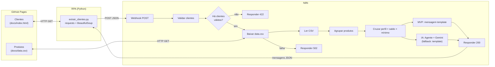

# Assistente de Investimentos com RPA + N8N + IA Generativa — Documentação

Documentação técnica da solução do desafio **"Criando um Assistente de Investimentos com RPA e IA Generativa"** (DIO).
Cobre a arquitetura, a execução passo a passo, as decisões técnicas, a verificação realizada e os limites conhecidos.

---

## 1. Visão geral

| Item | Descrição |
|---|---|
| **Problema** | Comunicar-se de forma personalizada com clientes de uma carteira, sem API disponível para ler os dados. |
| **Solução** | Um robô (RPA, Python) lê a tabela de clientes de uma página web e envia ao N8N; o workflow valida, cruza o perfil do cliente com a base de produtos e devolve uma mensagem personalizada por cliente. |
| **Duas versões** | **MVP:** mensagens por template (determinístico, auditável). **IA:** um Agente de IA reescreve a mensagem de forma única por cliente, com *guardrails* e fallback para o template. |
| **Regra central** | O cliente só recebe produtos do **seu perfil** cujo **aporte mínimo ≤ saldo**. |

## 2. Arquitetura



## 3. Estrutura do projeto

```
dio-assistente-investimentos-rpa-n8n/
├── README.md                    # enunciado original do desafio
├── DOCUMENTACAO.md              # este documento
├── docs/
│   ├── index.html               # página de clientes (fonte do RPA)
│   └── data.csv                 # opções de investimento por perfil
├── src/
│   ├── extrair_clientes.py      # RPA em linha de comando
│   └── extrair_clientes.ipynb   # mesma lógica, versão didática (Colab)
├── n8n/
│   ├── workflow.json            # ✅ MVP — mensagens estáticas   (webhook: /clientes)
│   ├── workflow-ia.json         # ✅ Desafio — Agente de IA       (webhook: /clientes-ia)
│   ├── build.py                 # gera os dois JSON a partir de n8n/src
│   └── src/                     # código dos nós Code (.js) e prompt do agente (.txt)
└── tests/
    ├── n8n_nodes.test.js        # 102 testes da lógica dos nós (node:test)
    ├── test_extrair_clientes.py # 101 testes do RPA e do notebook (unittest)
    └── fixtures/frases_ia.json  # bateria de regressão do guardrail da IA
```

> **Por que `build.py`?** O código dos nós Code vive em arquivos `.js` legíveis, revisáveis e testáveis; o script apenas os embute no JSON importável. Rodar de novo gera arquivos idênticos (IDs determinísticos) — editar o `.js` e rodar `python3 n8n/build.py` é o fluxo de manutenção.

## 4. Como executar

### 4.1 Pré-requisitos
Python 3.10+ (`pip install requests beautifulsoup4`), uma conta no [N8N Cloud](https://n8n.io/) ou N8N local, e Node 18+ apenas se for rodar os testes.

### 4.2 Passo a passo

| # | Ação | Resultado esperado |
|---|---|---|
| 1 | `python3 src/extrair_clientes.py --dry-run` | Lista os 10 clientes extraídos (não precisa do N8N). |
| 2 | No N8N: **Workflows → Import from file →** `n8n/workflow.json` | Workflow "Assistente de Investimentos — MVP" criado. Via CLI: `n8n import:workflow --input=n8n/workflow.json`. |
| 3 | Abra o nó **Config** e confira `csvUrl` | Deve apontar para o `data.csv` publicado **no GitHub Pages do seu fork** (o padrão aponta para o repositório original da DIO). |
| 4 | Ative o workflow e copie a **Production URL** do nó Webhook | Ex.: `https://SEU.app.n8n.cloud/webhook/clientes`. |
| 5 | `python3 src/extrair_clientes.py --webhook <Production URL>` | Resumo + uma mensagem por cliente. |
| 6 | (Opcional) `--saida resposta.json` | Grava a resposta completa do N8N. |

**Test URL × Production URL.** A *Test URL* (`/webhook-test/...`) só responde enquanto você clica em *Listen for test event* no editor; a *Production URL* (`/webhook/...`) exige o workflow ativo. O RPA aceita qualquer uma, via `--webhook` ou variável `N8N_WEBHOOK`.

### 4.3 Versão com IA
1. Importe `n8n/workflow-ia.json` (webhook próprio: `/webhook/clientes-ia` — os dois workflows podem ficar ativos juntos).
2. Abra o nó **Gemini Chat Model** e selecione sua credencial (*Google Gemini(PaLM) API*). Para OpenAI/Anthropic, troque o nó pelo equivalente e ligue-o à entrada *Chat Model* do **Agente de IA**.
3. Aponte o RPA para a URL `/webhook/clientes-ia`.

## 5. Contrato do Webhook

**Requisição** — `POST` com `Content-Type: application/json`:

```json
{ "clientes": [ { "nome": "Ana Silva", "email": "ana@email.com", "saldo": "R$ 12.500,00", "perfil": "Conservador" } ] }
```

**Respostas**

| HTTP | Quando | Corpo |
|---|---|---|
| **200** | Ao menos um cliente válido | `{ resumo, mensagens[], ignorados[] }` |
| **422** | Payload sem `clientes` ou sem nenhum cliente válido | `{ erro, recebidos, ignorados[] }` — cada ignorado traz `motivos` |
| **502** | Não foi possível baixar o `data.csv` | `{ erro, detalhe }` (detalhe limitado a 200 caracteres) |

Cada item de `mensagens`: `nome, email, perfil, saldo, saldoFormatado, produtosRecomendados[], assunto, mensagem, geradoPor`. Na versão IA, `geradoPor` é `ia` ou `template (fallback)` e `mensagemTemplate` guarda o texto original.

## 6. Fluxo do workflow (nó a nó)

| # | Nó | Tipo | Função |
|---|---|---|---|
| 1 | Webhook | Webhook v2 | Recebe o POST; `responseMode = responseNode` (a resposta sai de um nó *Respond to Webhook*). |
| 2 | Validar clientes | Code | Valida e padroniza cada cliente; separa `validos` e `ignorados` com motivos. Devolve **1 item**. |
| 3 | Tem clientes válidos? | IF | Falso → **Responder 422**. |
| 4 | Config | Set | Guarda `csvUrl` (único ponto a editar para trocar a fonte do CSV). |
| 5 | Baixar data.csv | HTTP Request | GET como arquivo; 3 tentativas; **saída de erro → Responder 502**. |
| 6 | Ler CSV | Extract From File | CSV → um item por produto. `alwaysOutputData`: CSV sem linhas não trava o fluxo. |
| 7 | Agrupar produtos | Aggregate | Todos os produtos num único item (`produtos`) — o CSV é lido **uma vez**, não uma por cliente. |
| 8 | Cruzar clientes × investimentos | Code | Filtra produtos por perfil e aporte mínimo; monta a mensagem. 1 item por cliente. |
| 9a | Montar resposta | Code | (MVP) consolida em `{ resumo, mensagens, ignorados }`. |
| 9b | Agente de IA + Gemini | AI Agent | (IA) escreve a mensagem de cada cliente. |
| 10b | Montar resposta (IA) | Code | (IA) aplica os *guardrails* e consolida. |
| 11 | Responder 200 / 422 / 502 | Respond to Webhook | Devolve o JSON ao RPA. |

## 7. Regras de negócio

| Regra | Comportamento |
|---|---|
| Nome | Obrigatório; espaços repetidos são normalizados. |
| E-mail | Formato válido e **único no lote** (duplicados ignorados). |
| Perfil | `Conservador`, `Moderado` ou `Arrojado` — sem distinção de maiúsculas/acentos. |
| Saldo | Formato brasileiro (`R$ 12.500,00`); arredondado a centavos; aceita `0`, rejeita negativo, letras (`1e3`), formato en-US (`12,500.00`) e valores acima de R$ 1 trilhão. |
| Elegibilidade | Produto do perfil com `minimo ≤ saldo` (inclusive: R$ 500 habilita um produto de mínimo R$ 500). |
| Sem produto elegível | A mensagem informa o produto de entrada do perfil e **quanto falta**. |
| Mínimo do CSV | Só `1000`, `1000.50` ou `1000,50`; vazio, negativo, `1e3`, `0x10` e `1.000` (ambíguo) descartam o produto — **nunca** viram R$ 0,00. |
| Aviso legal | Toda mensagem termina com "não constitui recomendação de investimento". |

## 8. Decisões técnicas

| Decisão | Alternativa descartada | Justificativa |
|---|---|---|
| Código dos nós em `.js` + `build.py` | Editar JavaScript direto no JSON | Revisável em *diff*, testável fora do N8N, sem escapar código dentro de JSON. |
| Validar **antes** de buscar o CSV | Validar no fim | Falha rápida: payload ruim responde 422 sem tocar na rede. |
| `Validar` devolve 1 item (`validos[]`) | 1 item por cliente | Garante que HTTP Request, Extract e Aggregate executem **uma única vez**. |
| Aggregate + Code para o cruzamento | Merge por perfil / lookup por item | O CSV tem 9 linhas; o cruzamento por regra (perfil **e** saldo) é mais simples e claro em código do que em nós de junção. |
| Respond to Webhook explícito (422/502/200) | Deixar o N8N responder | Com o CSV fora do ar, o N8N 2.35.7 respondeu **200 com corpo vazio** (observado em execução real); o RPA precisa de erro acionável. |
| `Config` (Set) com `csvUrl` | URL fixa no HTTP Request | Trocar a fonte do CSV exige editar um único campo visível. |
| Paths distintos (`/clientes`, `/clientes-ia`) e IDs únicos | Mesmo path nos dois | Dois workflows com o mesmo path não podem ficar ativos juntos. |
| Textos de perfil **genéricos** | Texto citando produtos | O cliente só vê os produtos que o saldo permite; texto genérico nunca promete o que não é oferecido. |
| Agente de IA **sem retry** | `retryOnFail` | O N8N só inspeciona o 1º item e reexecutaria o **lote inteiro** (custo dobrado); o fallback por cliente já cobre a falha. |
| Fallback para template | Falhar a requisição | O RPA sempre recebe uma resposta utilizável, mesmo sem cota/credencial de IA. |
| Conversão manual de moeda (`brl`) | `toLocaleString('pt-BR')` | Não depende do ICU do servidor; saída idêntica em qualquer ambiente. |

## 9. Exemplo de saída (gerado pelo próprio código dos nós)

**Ana Silva** — Conservador, R$ 12.500,00:

```
Olá, Ana!

Seu perfil de investidor é Conservador e o seu saldo atual é R$ 12.500,00.
Seu perfil prioriza segurança e liquidez, por isso selecionamos opções de renda fixa com menor risco.

Opções compatíveis com o seu perfil e o seu saldo:
• Poupança — aporte mínimo R$ 100,00 — rentabilidade 6,2%
• CDB Liquidez Diária — aporte mínimo R$ 1.000,00 — rentabilidade 12,5%
• Tesouro Selic — aporte mínimo R$ 500,00 — rentabilidade 13,0%

Concentrar sua carteira em renda fixa ajuda a proteger o patrimônio e a manter sua reserva disponível quando precisar.

Esta mensagem é informativa e não constitui recomendação de investimento; rentabilidade passada não garante resultado futuro. Rentabilidade e liquidez variam conforme o produto e o emissor.
```

**Daniel Oliveira** — Conservador, R$ 850,00: recebe apenas **Poupança** e **Tesouro Selic**; o *CDB Liquidez Diária* (mínimo R$ 1.000) não é oferecido.

## 10. IA generativa — como funciona e onde estão os limites

**Entrada do agente (por cliente):** nome, perfil, saldo e a lista de produtos **já filtrada** pelo cruzamento. A IA nunca decide *quais* produtos oferecer — só *como escrever*.

**Prompt de sistema** (`n8n/src/prompt_agente_ia.txt`): persona de assessor, uso exclusivo dos produtos listados, proibição de prometer retorno, 90–140 palavras, tom cordial, dica prática por perfil, aviso legal ao final.

**Guardrails no nó "Montar resposta (IA)":**

| Situação | Ação |
|---|---|
| Erro, cota esgotada ou texto vazio | Usa a mensagem-template (`template (fallback)`) |
| Cliente **sem nenhum produto elegível** | Descarta o texto da IA e usa o template (`template (sem produtos elegíveis)`): sem produto na lista, o modelo poderia inventar um. O agente ainda é chamado para esse cliente (custo marginal); evitar a chamada exigiria um ramo extra no fluxo. |
| Promessa/garantia de retorno ("retorno garantido", "risco zero", "100% segura"…) | Descarta o texto da IA; usa o template |
| Sem o aviso "não constitui recomendação" | Mantém o texto da IA e **anexa** o aviso padrão |
| Frases legítimas com negação ("não garantimos retorno", "FGC garante até R$ 250 mil") | **Não** são descartadas |

> ⚠️ **O filtro de promessas é heurístico.** Na bateria de regressão (`tests/fixtures/frases_ia.json`: 114 frases, 44 legítimas e 70 promessas, mais 2 ambíguas), o filtro final acerta todas. A bateria, porém, foi escrita por nós: ela mede o que **imaginamos**, não o que o modelo real vai escrever. Antes de produção, recomenda-se (a) **revisão humana** ou aprovação antes do envio ao cliente e (b) amostragem periódica das mensagens geradas. O filtro **não** valida se a IA citou um produto fora da lista — a defesa para isso é o prompt (regra 1) e a revisão.

## 11. Verificação realizada

A solução foi verificada por **agentes independentes** (cada um sem acesso ao raciocínio do autor), com céticos tentando refutar cada achado. O N8N usado foi o **2.35.7** real, instalado no ambiente de desenvolvimento.

| Rodada | Escopo | Resultado |
|---|---|---|
| **1** | N8N real + testes de lógica + testes do RPA + revisão de schema contra o código-fonte dos nós | 6 problemas confirmados, 0 refutados. Todos corrigidos. Os mais relevantes: import falhava (JSON sem `id`) e falha no download do CSV respondia **200 vazio**. |
| **2** | Regressão em N8N real (42 testes) + revisão adversarial do diff (170 testes/baterias) | Regressão sem problemas médios ou maiores. Revisão achou 4 defeitos confirmados (guardrail frágil: 42 falsos negativos em 116 frases; saldo en-US lido como R$ 12,50; texto de perfil incoerente; `<tfoot>` virando cliente). Todos corrigidos. |
| **3** | N8N real (2.35.7), só o que mudou: CSV sem linhas, corpo do 502, guardrail integrado, import, RPA | **20 de 20 testes aprovados.** CSV só com cabeçalho, vazio (0 bytes) e HTML no lugar do CSV: Webhook responde 200 em < 0,3 s (antes podia ficar sem resposta). 502 com `{erro, detalhe}` em ~4 s (3 tentativas), `detalhe` cortado em exatamente 200 caracteres. IA com mock: 10 chamadas para 10 clientes (sem retry); “retorno garantido”, “O retorno é garantido.” e “Livre de risco.” → template; “Não garantimos retorno…” → mantida como `ia`. Dois pontos de baixa gravidade foram corrigidos depois (nota abaixo). |

> **Ajustes posteriores à rodada 3.** Dois pontos de baixa gravidade levantados pela própria rodada 3 foram corrigidos depois dela: (1) quando a mensagem cita Criptomoedas como “porta de entrada” (cliente Arrojado com saldo abaixo de R$ 100), o aviso de volatilidade agora acompanha; (2) cliente sem produto elegível não usa mais o texto da IA. Essas duas mudanças são **lógica dos nós Code** e estão cobertas pelos testes automatizados, mas **não foram reexecutadas num N8N real** — o fluxo de integração foi validado nas rodadas anteriores e a estrutura dos workflows não mudou.

**Suítes automatizadas** (sem rede, sem dependências além das do projeto):

```bash
node --test tests/n8n_nodes.test.js                 # 102 testes — lógica dos nós, estrutura dos workflows, guardrail
python3 -m unittest discover -s tests               # 101 testes (1 pulado: validação formal do notebook exige nbformat)
```

**O que NÃO foi verificado (limites declarados):**

| Limite | Impacto |
|---|---|
| **Gemini real** — o caminho de IA foi exercitado com um modelo OpenAI-compatível **simulado** (mock), não com o Gemini | O texto real e a latência podem divergir; credencial e cota são responsabilidade de quem implanta. |
| **Importação pela interface web** do N8N — testada só pela CLI | Esperado funcionar (mesmo formato), mas não foi observado. |
| **GitHub Pages real** — o download do CSV foi testado com servidor local | Garanta que o Pages do seu fork está publicado e ajuste `csvUrl`. |
| **Outras versões do N8N** — só a 2.35.7 | Versões 1.x antigas podem não ter alguns *typeVersions* usados. |
| **Volume** — lotes de 10 a 15 clientes | Sem medição de desempenho para lotes grandes. |

## 12. Riscos e conformidade

| Tema | Risco | Recomendação |
|---|---|---|
| **Adequação (suitability)** | O perfil vem pronto da base; a solução não avalia se ele está atualizado. | Garantir que o perfil siga a política de suitability da instituição. |
| **Aviso e promessa de retorno** | Mensagem de IA pode induzir expectativa de ganho. | Guardrails + aviso legal obrigatório + revisão humana (seção 10). |
| **Segurança do Webhook** | A URL, por padrão, aceita qualquer POST. | Ativar *Header Auth* no nó Webhook e enviar o segredo pelo RPA; não expor a URL publicamente. |
| **Dados pessoais (LGPD)** | O N8N guarda os dados das execuções (nome, e-mail, saldo). | Os dados deste projeto são fictícios. Em produção: minimizar, definir retenção das execuções e restringir acesso. |
| **Disponibilidade do CSV** | GitHub Pages fora do ar. | Já tratado com 3 tentativas e **502** explicativo; considerar um espelho. |
| **Credenciais** | Chave de IA em texto. | Usar o cofre de credenciais do N8N; o JSON exportado **não** contém segredos. |

## 13. Checklist dos entregáveis

| Entregável | Status | Observação |
|---|---|---|
| Workflow N8N com mensagens estáticas (MVP) | ✅ Pronto | `n8n/workflow.json`, executado em N8N real. |
| Script de RPA integrado ao Webhook | ✅ Pronto | `src/extrair_clientes.py` e notebook; E2E real com 10 clientes. |
| Agente de IA no N8N | ✅ Pronto (com ressalva) | `n8n/workflow-ia.json`; testado com mock OpenAI-compatível. **Falta testar com sua credencial Gemini.** |
| Mensagens geradas por LLM | ✅ Pronto (com ressalva) | Mesma ressalva acima. |
| Documentação das decisões técnicas | ✅ Pronto | Este documento. |
| **Print ou vídeo do fluxo funcionando** | ⏳ **A fazer por você** | Exige a sua instância do N8N. Sugestão de roteiro na seção 14. |
| Repositório forkado com os arquivos | ✅ Pronto | Solução publicada na branch `main` deste fork. O notebook original da DIO continua em `rpa/`; a versão final, com o envio ao Webhook, está em `src/` (como o README do desafio manda). |

## 14. Próximos passos para concluir a entrega

**Publicar o GitHub Pages do fork** (*Settings → Pages → Deploy from branch → `main` → `/docs`*) e, no nó **Config** de cada workflow, trocar o `csvUrl` para o `data.csv` do seu fork (o padrão aponta para o repositório original da DIO). Se alterar o padrão no código, edite `URL_CSV` em `n8n/build.py` e rode `python3 n8n/build.py`.

**Roteiro sugerido para o vídeo/print (≈ 2 min):**
1. Mostrar a página de clientes e o `data.csv`.
2. Mostrar o workflow no editor e o nó **Config**.
3. Rodar `python3 src/extrair_clientes.py --webhook <URL>` e mostrar as mensagens.
4. Abrir a execução no N8N e destacar o cruzamento (ex.: Daniel, R$ 850, sem o CDB).
5. (IA) Repetir com `/webhook/clientes-ia` e comparar `mensagem` × `mensagemTemplate`.

## 15. Evoluções possíveis

- Enviar as mensagens por e-mail (Gmail/SMTP) **após aprovação** humana.
- Agendar o RPA (Cron) e registrar cada execução em planilha (trilha de auditoria).
- Autenticação no Webhook e *rate limit*.
- Rodar as duas suítes de teste em CI (GitHub Actions) a cada push.
- Validar, no guardrail, se a IA citou algum produto fora da lista elegível.
